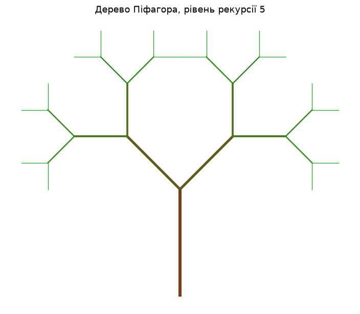
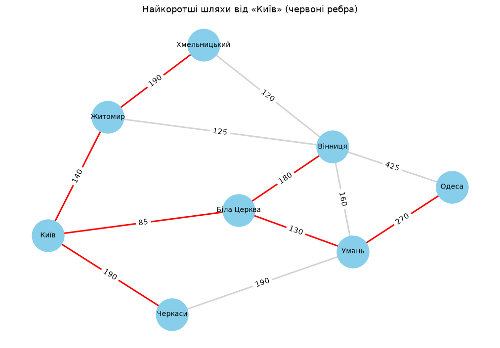
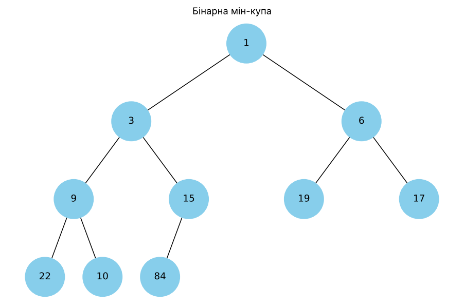
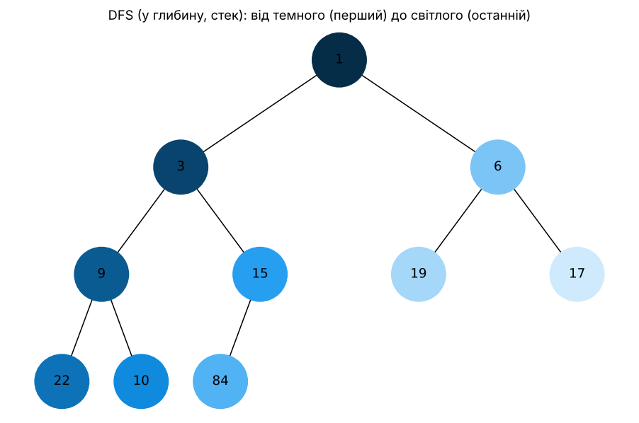
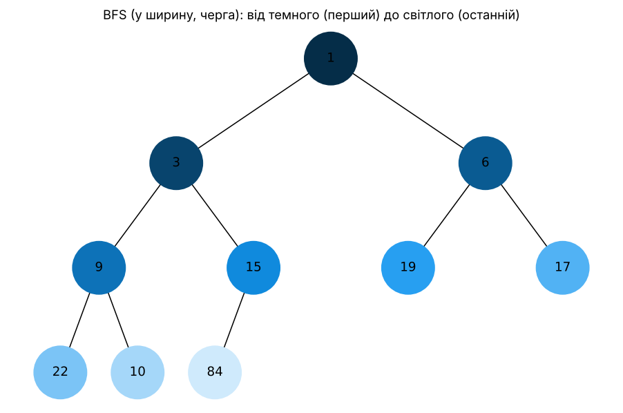
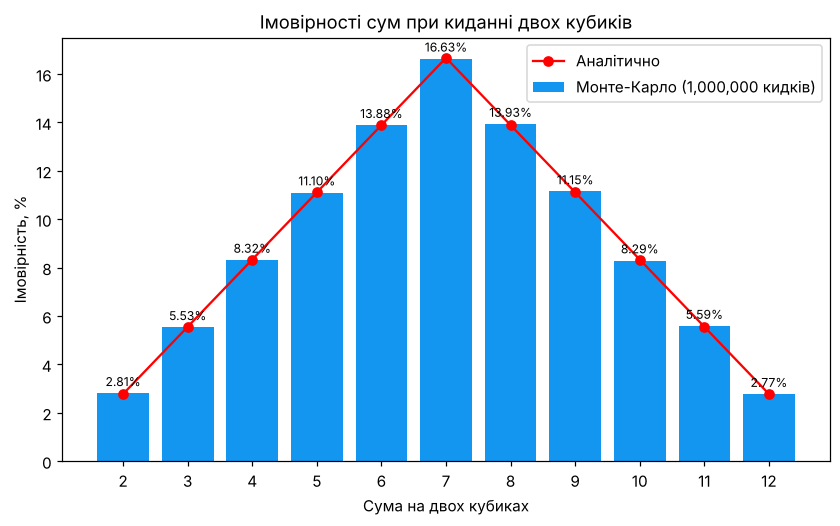

# goit-algo-fp

Фінальний проєкт з курсу «Алгоритми та структури даних». Усі сім завдань зібрано у файлі `goit-algo-fp.py`.

```bash
pip install matplotlib networkx
python goit-algo-fp.py        # меню з вибором завдання
python goit-algo-fp.py 7      # одразу конкретне завдання
```

Графіки зберігаються в папку `images/`.

## Завдання 1. Однозв'язний список

- `LinkedList.reverse()` розвертає список на місці, перенаправляючи посилання `next` кожного вузла на попередній. Складність O(n) за часом і O(1) за пам'яттю.
- `LinkedList.sort()` — сортування злиттям. Список ділиться навпіл методом повільного й швидкого вказівників, а відсортовані половини зливаються без створення нових вузлів. Складність O(n log n). Для зв'язного списку це кращий вибір, ніж сортування вставками (O(n²)), бо злиття не потребує довільного доступу за індексом.
- `merge_sorted_lists(list1, list2)` об'єднує два відсортовані списки в новий відсортований список за O(n + m) і не змінює вихідні списки.

```
Початковий список:      5 -> 3 -> 8 -> 1 -> 9 -> 2
Після реверсування:     2 -> 9 -> 1 -> 8 -> 3 -> 5
Після сортування:       1 -> 2 -> 3 -> 5 -> 8 -> 9
Об'єднаний список:     1 -> 2 -> 3 -> 4 -> 7 -> 8 -> 10 -> 12 -> 15
```

## Завдання 2. Дерево Піфагора

Рекурсивна функція `draw_pythagoras_branch()` малює гілку, а з її кінця запускає дві менші гілки під кутами +45° і −45°. Довжина кожної нової гілки в √2/2 раз менша, як у класичному дереві Піфагора. Рівень рекурсії вводить користувач (від 1 до 16). Колір змінюється від коричневого стовбура до зелених кінчиків.



## Завдання 3. Алгоритм Дейкстри

Граф — зважена мережа доріг між містами (відстані в км). Функція `dijkstra()` використовує бінарну купу `heapq`, щоб щоразу за O(log V) вибирати вершину з найменшою поточною відстанню. Застарілі записи в купі пропускаються. Загальна складність O((V + E) log V). Результат перевірено: він збігається з `networkx.single_source_dijkstra_path_length`.

| Місто | Відстань від Києва | Шлях |
|---|---:|---|
| Біла Церква | 85 | Київ → Біла Церква |
| Житомир | 140 | Київ → Житомир |
| Черкаси | 190 | Київ → Черкаси |
| Умань | 215 | Київ → Біла Церква → Умань |
| Вінниця | 265 | Київ → Біла Церква → Вінниця |
| Хмельницький | 330 | Київ → Житомир → Хмельницький |
| Одеса | 485 | Київ → Біла Церква → Умань → Одеса |



## Завдання 4. Візуалізація бінарної купи

На основі наданого коду (`Node`, `add_edges`, `draw_tree`) створено функцію `heap_to_tree()`. Вона перетворює купу, збережену як масив, на дерево: для елемента з індексом `i` лівий нащадок має індекс `2i + 1`, а правий `2i + 2`. Функція `draw_heap()` спочатку перетворює список на мін-купу через `heapq.heapify`, а потім малює її.



## Завдання 5. Обходи DFS і BFS

Обидва обходи реалізовано **без рекурсії**:
- `dfs_order()` — обхід у глибину за допомогою **стека**. Правий нащадок кладеться в стек першим, щоб лівий обробився раніше;
- `bfs_order()` — обхід у ширину за допомогою **черги** (`collections.deque`).

Функція `generate_colors()` генерує унікальний колір у форматі `#RRGGBB` для кожного кроку: від темного `#052D48` (перший відвіданий вузол) через базовий `#1296F0` до світлого `#CFEAFC` (останній). За відтінком видно порядок обходу.

| DFS | BFS |
|---|---|
|  |  |

DFS: `1 → 3 → 9 → 22 → 10 → 15 → 84 → 6 → 19 → 17`. Обхід спочатку йде вглиб лівої гілки.
BFS: `1 → 3 → 6 → 9 → 15 → 19 → 17 → 22 → 10 → 84`. Обхід іде рівень за рівнем.

## Завдання 6. Жадібний алгоритм і динамічне програмування

- `greedy_algorithm(items, budget)` сортує страви за співвідношенням калорій до вартості й бере їх, доки вистачає бюджету. Складність O(n log n).
- `dynamic_programming(items, budget)` розв'язує задачу рюкзака 0/1: `dp[i][b]` — максимальна калорійність із перших `i` страв при бюджеті `b`. Потім набір страв відновлюється з таблиці. Складність O(n · budget). Результат перевірено повним перебором для всіх бюджетів від 0 до 200.

Для бюджету 100:

| Алгоритм | Страви | Вартість | Калорійність |
|---|---|---:|---:|
| Жадібний | cola, potato, pepsi, hot-dog | 80 | 870 |
| ДП | pizza, pepsi, cola, potato | 100 | **970** |

Жадібний алгоритм зупиняється, коли наступна найвигідніша страва вже не вміщується, і 20 одиниць бюджету залишаються невикористаними. ДП розглядає всі комбінації й знаходить кращий набір. Для бюджетів 50, 80, 120 і 170 обидва алгоритми дають однаковий результат, а для 30 і 100 ДП кращий. Отже, жадібний підхід швидкий, але оптимальність не гарантує. ДП гарантує оптимум ціною більшої кількості обчислень і пам'яті.

## Завдання 7. Метод Монте-Карло: два кубики

Програма кидає два кубики **1 000 000 разів**, рахує, скільки разів випала кожна сума від 2 до 12, і ділить кількість на загальну кількість кидків.

| Сума | Випадінь | Монте-Карло | Аналітично | Різниця |
|---:|---:|---:|---:|---:|
| 2 | 28 068 | 2.81% | 2.78% (1/36) | +0.03 |
| 3 | 55 336 | 5.53% | 5.56% (2/36) | −0.02 |
| 4 | 83 168 | 8.32% | 8.33% (3/36) | −0.02 |
| 5 | 111 004 | 11.10% | 11.11% (4/36) | −0.01 |
| 6 | 138 835 | 13.88% | 13.89% (5/36) | −0.01 |
| 7 | 166 297 | 16.63% | 16.67% (6/36) | −0.04 |
| 8 | 139 322 | 13.93% | 13.89% (5/36) | +0.04 |
| 9 | 111 468 | 11.15% | 11.11% (4/36) | +0.04 |
| 10 | 82 918 | 8.29% | 8.33% (3/36) | −0.04 |
| 11 | 55 859 | 5.59% | 5.56% (2/36) | +0.03 |
| 12 | 27 725 | 2.77% | 2.78% (1/36) | −0.01 |



Як змінюється точність із кількістю кидків (максимальне відхилення від аналітичних значень):

| Кидків | Макс. відхилення, п.п. |
|---:|---:|
| 100 | 7.889 |
| 1 000 | 1.544 |
| 10 000 | 0.631 |
| 100 000 | 0.182 |
| 1 000 000 | 0.064 |

### Висновки

1. **Розрахунки методом Монте-Карло правильні.** На мільйоні кидків кожна ймовірність відрізняється від аналітичної не більше ніж на 0.043 процентного пункту. Форма розподілу точно повторює теоретичну: «трикутник» з максимумом на сумі 7 (16.63 % проти 16.67 %) і симетричними спадами до сум 2 і 12.
2. **Найімовірніша сума — 7**, бо її можна отримати найбільшою кількістю способів (6 із 36: 1+6, 2+5, 3+4, 4+3, 5+2, 6+1). Суми 2 і 12 найрідші: для кожної є лише один спосіб.
3. **Точність залежить від кількості кидків.** На 100 кидках похибка сягає майже 8 п.п., тобто результат майже непридатний. Збільшення кількості кидків у 100 разів зменшує похибку приблизно в 10 разів, що відповідає закону похибки методу Монте-Карло ~1/√N.
4. **Метод корисний там, де аналітика складна.** Для двох кубиків точну відповідь легко порахувати вручну, тож тут симуляція лише підтверджує теорію. Але той самий код без змін можна застосувати до складніших задач (більше кубиків, нечесні кубики, складні правила гри), де формулу вивести важко, а симуляція так само дає надійну оцінку.
