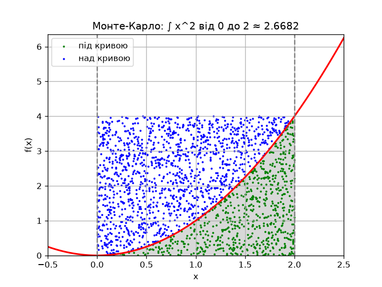

# goit-algo-hw-10

Домашня робота до тем 9 та 10: жадібні алгоритми, динамічне програмування та метод Монте-Карло. Обидва завдання зібрано у файлі `goit-algo-hw-10.py`.

```bash
pip install numpy scipy matplotlib
python goit-algo-hw-10.py
```

## Завдання 1. Видача решти

Набір монет: `[50, 25, 10, 5, 2, 1]`.

- `find_coins_greedy(amount)` — жадібний алгоритм. Він бере найбільший номінал, який вміщується в залишок, і через `divmod` одразу рахує, скільки таких монет потрібно. Для суми 113 повертає `{50: 2, 10: 1, 2: 1, 1: 1}`.
- `find_min_coins(amount)` — динамічне програмування. Масив `min_coins[s]` зберігає мінімальну кількість монет для кожної суми від 0 до `amount`, а `last_coin[s]` — останню використану монету, щоб потім відновити набір. Для суми 113 повертає `{1: 1, 2: 1, 10: 1, 50: 2}`.

### Час виконання

Найкращий результат із 3 запусків `timeit`, у секундах:

| Сума | Жадібний | ДП | У скільки разів ДП повільніший |
|---:|---:|---:|---:|
| 113 | 0.0000004 | 0.00003 | 76 |
| 1 000 | 0.0000005 | 0.00035 | 737 |
| 10 000 | 0.0000004 | 0.00358 | 9 195 |
| 100 000 | 0.0000007 | 0.03255 | 47 870 |
| 1 000 000 | 0.0000005 | 0.34978 | 688 552 |

### Аналіз складності

| | Жадібний | Динамічне програмування |
|---|---|---|
| Час | O(k), k — кількість номіналів | O(n · k), n — сума |
| Пам'ять | O(k) | O(n) |
| Оптимальність | лише для «канонічних» наборів монет | завжди |

- **Жадібний алгоритм** не залежить від розміру суми: завдяки `divmod` він робить лише по одній операції на кожен номінал. Тому час практично сталий, близько 0.5 мкс, що для 113, що для мільйона.
- **Динамічне програмування** розв'язує підзадачу для кожної суми від 1 до n, тому час росте лінійно. Збільшення суми в 10 разів збільшує час приблизно в 10 разів (0.0036 → 0.033 → 0.35 с). Пам'ять теж росте лінійно: для мільйона потрібні два списки по мільйону елементів.

### Коли який алгоритм кращий

Набір `[50, 25, 10, 5, 2, 1]` **канонічний**: для нього жадібний вибір завжди оптимальний. Програма перевіряє це для всіх сум у таблиці, і обидва алгоритми дають однакову кількість монет. Отже, для касового апарата з таким набором **жадібний алгоритм — найкращий вибір**: результат той самий, а на великих сумах він швидший у сотні тисяч разів.

Для неканонічних наборів жадібний алгоритм може помилитися. Наприклад, для монет `[4, 3, 1]` і суми 6 він видасть `4 + 1 + 1` (3 монети), а ДП знайде оптимальне `3 + 3` (2 монети). Цей приклад теж є в програмі.

**Висновок:** якщо набір монет фіксований і канонічний, як у більшості реальних валют, варто використовувати жадібний алгоритм. Динамічне програмування потрібне тоді, коли набір довільний і оптимальність треба гарантувати, а сума не надто велика.

## Завдання 2. Інтеграл методом Монте-Карло

Функція: f(x) = x², межі інтегрування [0, 2].

**Метод.** У прямокутник [0, 2] × [0, 4] (4 = f(2), максимум функції на відрізку) кидаємо N випадкових точок і рахуємо частку тих, що потрапили під криву. Площа під кривою ≈ площа прямокутника (8) × частка влучань. Генератор випадкових чисел — `numpy.random.default_rng(42)`, тому результати відтворювані.



### Перевірка

- Аналітично: ∫₀² x² dx = x³/3 |₀² = 8/3 ≈ **2.666667**
- SciPy `quad`: **2.666667**, оцінка похибки 3·10⁻¹⁴

| Кількість точок | Монте-Карло | Абсолютна похибка | Похибка, % |
|---:|---:|---:|---:|
| 100 | 2.720000 | 0.053333 | 2.000 |
| 1 000 | 2.656000 | 0.010667 | 0.400 |
| 10 000 | 2.636000 | 0.030667 | 1.150 |
| 100 000 | 2.678160 | 0.011493 | 0.431 |
| 1 000 000 | 2.664552 | 0.002115 | 0.079 |
| 10 000 000 | 2.664572 | 0.002095 | 0.079 |

30 незалежних запусків по 100 000 точок: середнє **2.66680**, стандартне відхилення **0.00902**.

### Висновки

1. **Метод Монте-Карло дає правильний результат.** Уже за мільйона точок похибка менша за 0.1 %, а середнє з 30 запусків (2.66680) відрізняється від точного значення 2.66667 лише в четвертому знаку після коми.
2. **Точність росте повільно**, приблизно як 1/√N: щоб зменшити похибку в 10 разів, потрібно в 100 разів більше точок. Похибка також зменшується не монотонно (на 10 000 точок вона більша, ніж на 1 000), бо кожен результат випадковий. Тому одного запуску з невеликою кількістю точок недостатньо, і краще дивитися на середнє та розкид кількох запусків.
3. **`quad` точніший і швидший** для гладкої функції однієї змінної: він дає похибку близько 10⁻¹⁴ за частки мілісекунди. Метод Монте-Карло тут відіграє роль перевірки та ілюстрації.
4. **Де Монте-Карло справді виграє.** Його похибка не залежить від розмірності задачі. Тому для багатовимірних інтегралів, складних областей інтегрування або моделей, де аналітичний розв'язок неможливий, це часто найпрактичніший інструмент.
